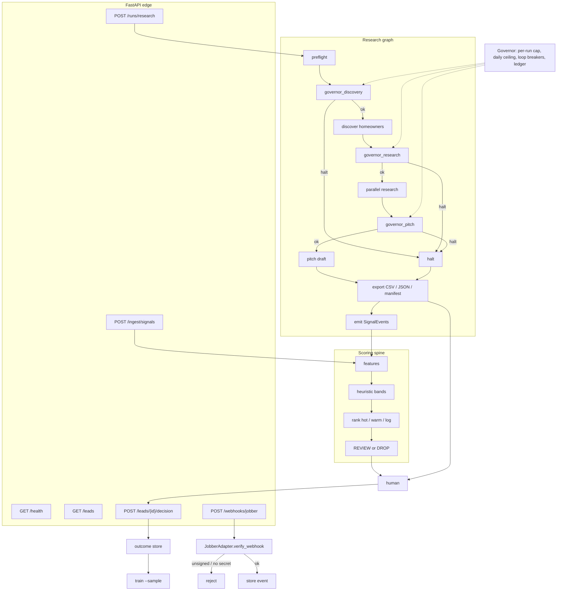

# NightForge LeadForge

> Demand-side research for trades shops. LangGraph gates every paid call. Nothing sends without a human.

NightForge finds homeowners who publicly asked for HVAC, plumbing, electrical, or roofing work, drafts a reply a local shop would send, scores the demand, and stops when the budget says stop. There is no email or SMS send path. Every export row is `Human Review: YES`.

This README describes the **production system** in `nightforge/`: a LangGraph research graph, a fail-closed governor, a readable scoring spine, and a FastAPI edge. The CrewAI + Streamlit pipeline in `leadforge/` is still in the tree as a working prototype. It is not the architecture anymore.

## Why this exists

Most agent demos wander until the invoice arrives. NightForge is built the other way around: bounded graph nodes, a pre-call budget gate, loop limits that fire before dollars do, and a scoring policy you can read without opening a notebook. I use it for Barren Business Development. A person still decides what happens to every lead.

## Problem

Owner-led trades shops drown in inbound demand they cannot triage: after-hours posts, weather-driven emergencies, half-complete directory mentions. The job is not "find more businesses." It is: **see public demand, research it, draft a specific reply, rank it, and refuse to auto-contact anyone.**

## Architecture



What is deliberately not on that diagram: a send node, an OAuth route, and an auto-`ROUTE` decision. Those do not exist.

| Piece | Role |
| --- | --- |
| `nightforge/graphs/research.py` | LangGraph: preflight → gated discover → gated parallel research → gated pitch → export → emit signals. Halt still exports. |
| `nightforge/governor.py` | Pre-call gate for every LLM and paid search call. Per-run cap, per-day ceiling, loop breakers, fail-closed ledger. |
| `nightforge/scoring/` | Signals → features → written rules → zone/unit suggestion → ranked JSON. No model. |
| `nightforge/api/app.py` | Health, run submit/lookup, signal ingest, lead list, human decision, Jobber webhook. |
| `nightforge/adapters/` | Vendor SDKs stay behind a protocol. Jobber verifies HMAC; writes are stubs. |
| `leadforge/models.py` | Shared export contract. A homeowner is mapped onto those columns so the CSV shape does not fork. |

### Trade-offs

- **Bounded graph nodes instead of a CrewAI tool loop.** Each spending phase is gate → work → gate. That makes the budget check exhaustive. The cost is less autonomous recovery when a tool call is weird; retries are counted and capped.
- **Heuristic scoring instead of a fitted model.** Every band traces to a rule in `nightforge/scoring/heuristic.py`, and every rule names the signals it used. The `train` slot exists and will not fit until there are enough labels. Readable policy now, learned policy later.
- **Prototype kept beside production.** Shared Pydantic contracts and the same CSV columns. Dual stack is extra surface area; deleting `leadforge/` is a later move, not this one.
- **In-memory run and lead stores.** Fine for a local demo. A process restart forgets them; the JSON/CSV artifacts on disk are the durable copy.
- **Inbound graph is a placeholder.** The webhook verifies and stores. It does not hydrate Jobber records or place drafts yet.
- **Paid search is on the ledger here.** In the prototype, Tavily/Brave spend never touched `CostTracker`. That was a hole; the governor closes it.

## How to run

Python 3.10–3.12. No API key is required for sample mode, scoring, training, tests, or evals.

```bash
git clone https://github.com/DannyBarren/NightForge-LeadForge.git
cd NightForge-LeadForge
python3 -m venv .venv
source .venv/bin/activate
pip install -r requirements.txt
cp .env.example .env
```

```bash
make research-sample   # LangGraph, 3 demo households, seeds + fallbacks
make score-sample      # same three households, ranked hot / warm / log
python -m nightforge.cli train --sample
python -m nightforge.cli research --dry-run
make serve             # FastAPI at 127.0.0.1:8000
make test              # pytest
make lint              # ruff
make eval              # labeled offline eval report
```

Live research (spends money, still does not send):

```bash
# put OPENAI_API_KEY in .env; TAVILY_API_KEY is recommended
python -m nightforge.cli research --zip 85001 --max-leads 5 --budget 8
```

The CrewAI + Streamlit prototype still runs: `make ui`, `make demo`. See [docs/DEMO.md](docs/DEMO.md). Architecture notes: [docs/ARCHITECTURE.md](docs/ARCHITECTURE.md). Branch policy: [docs/PRODUCTION.md](docs/PRODUCTION.md).

## Guardrails

| Control | Value | Where |
| --- | --- | --- |
| Recommended per-run cap | $8.00 | `Governor` / `config/settings.yaml` |
| Hard ceiling | $10.00 | clamped; preflight errors above this |
| Projected early stop | $7.25 | stop when remaining work cannot finish |
| Inbound default cap | $2.00 | inbound runs do less LLM work |
| Daily per-client ceiling | $10.00 default | run is *deferred*, not started |
| Loop limits | scale with lead count | iterations, tool calls, repeats, HTTP retries |
| Human review | always `YES` | model + graph + export |
| Send path | none | no route, no adapter method |

`LEADFORGE_BUDGET_USD` above 10 fails preflight. Sample mode without a provider key skips the live attempt and uses demo seeds, so a demo cannot die on a missing key. A production run still halts.

## Failure modes

- **Missing provider key.** Production: preflight fails, run does not start. Sample: seeds and deterministic fallback pitches, three complete rows.
- **GovernorHalt.** Clean stop mid-run. Manifest gets `stopped_early` and a `stop_reason`. Completed rows still export.
- **GovernorDeferred.** Daily ceiling would be exceeded. Nothing is spent; retry tomorrow.
- **Loop breaker.** A wedged retry loop trips before it burns the dollar cap.
- **Unmetered LLM call.** Booked with a chars/4 floor, never at $0.
- **Webhook.** Missing `JOBBER_WEBHOOK_SECRET`, missing `X-Jobber-Hmac-SHA256`, or a mismatch → reject. No default-allow.
- **Search or LLM down during sample.** Exceptions are swallowed on the live path; seeds fill the gap.
- **Overnight workflow.** Manual `workflow_dispatch` only. If `OPENAI_API_KEY` is unset, the job skips and stays green. See below.

## Cost and latency

Figures below are either **measured** on this change (Linux, Python 3.12.3, no provider keys) or **labeled estimates**. Live 30-lead cost was not measured.

| Path | What | Result |
| --- | --- | --- |
| `research --sample` (no keys) | measured | 3 rows, **$0.0000**, **0.018 s** graph time |
| `score --sample` | measured | 3 leads, no network, **0.0007 s** |
| `pytest tests/` | measured | 208 tests, **3.45 s** (suite time) |
| Offline eval harness (12 cases) | measured | **12/12 pass**, **2.72 s** |
| 30-lead live run | **not measured** | — |
| Search API spend | **not measured** | now gated, still not metered at vendor rates |

Token **estimate** for a 30-lead run at the `gpt-4o-mini` list prices in `config/settings.yaml` ($0.15 / $0.60 per 1M tokens), using the governor's `EST_*` constants and ignoring search, retries, and page fetches:

`discovery (3k/4k) + 30 × (research 2.5k/2k + pitch 1.8k/1.2k) ≈ $0.08` of LLM tokens.

That is a paper estimate, not a bill. The $8 cap is a policy ceiling so a wedged or retried run cannot surprise you. The overnight workflow comments that used to say "$2–8 per run" were not backed by a measurement and are not repeated here as fact.

## Offline evals

`evals/cases.json` is a small labeled set: scoring bands, governor admission, sample-graph export, and safety (no send path, webhook fail-closed, human review pinned). `evals/fixtures/expected_sample_scores.json` is a recorded snapshot of the three demo households.

```bash
python -m evals.harness
python -m evals.harness --json evals/report.json
```

The harness strips provider keys before it runs. It will not call a paid API. A failure exits 1.

## Overnight workflow

`.github/workflows/overnight-leads.yml` is **manual only**. Fifteen historical runs failed in 0 seconds with no jobs. Cause, verified from GitHub: the file used `if: ${{ secrets.GOOGLE_SHEETS_CREDENTIALS_JSON != '' }}`. GitHub's validator rejects `secrets` in `if:` (`Unrecognized named-value: 'secrets'`), records a failed `push` run, and never starts the job. The cron schedule was already commented out; it was not the cause.

The file no longer uses `secrets` in `if:`. Missing `OPENAI_API_KEY` skips the spend path and the job succeeds. Uncomment the schedule only after adding repository secrets, and only if you intend to spend.

## Output

Production sample runs write the same export shape as the prototype, plus a scored artifact:

- `data/output/leads_<run_id>.csv` / `.json`
- `data/output/manifest_<run_id>.json`
- `data/output/token_usage_<run_id>.json`
- `data/output/scored_<batch_id>.json`

Demo seeds use `example.com` URLs and 555 phone numbers on purpose. `data/output/sample_leads_output.csv` is a checked-in fake for the prototype CSV shape.

## What this is evidence of

- A LangGraph pipeline with a governor in front of every paid node, not a notebook
- A scoring policy you can audit without a model card
- Fail-closed webhooks and no send path, tested
- Sample mode and an eval harness that stay green without API keys
- A public repo that does not pretend the CrewAI prototype is still the product

## License

MIT. See [LICENSE](LICENSE).
